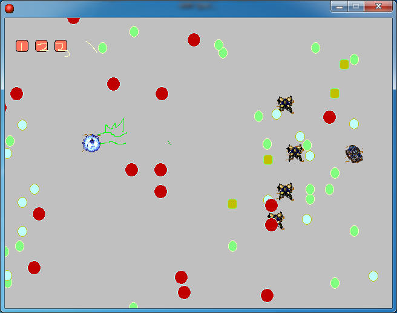

# Archon's Adventure

[한국어](README.ko.md)

A game where you play StarCraft's Archon and push forward while dodging the barrage of shots a Dragoon army pours out. It has stages, boss fights and sound.

  

## How to play

Download it from Releases and run it.

Move the Archon with the arrow keys and hold space to stop. Touching a Dragoon shot kills you. Once you get past the stage, three boss fights follow in a row.

The difficulty is a real test of patience, so pressing 1 to 4 on the death screen lets you jump to the section you want. 1 takes you to the stage, and 2 to 4 take you to each boss fight.

## How it works

The whole flow is five rooms: one stage, one death screen and three boss fights. The cheat keys come from an object placed on the death screen. It has key events for 1 to 4, and each one has an action that sends you to a different room. Progress is handled purely by moving between rooms, with nothing saved separately.

## Files

| Path | Contents |
|---|---|
| `source/archon-adventure.gmk` | Original project file |
| `source/split/` | Text tree produced by GmkSplitter |
| `docs/screenshots/` | Screenshots |
| Releases | Distributed build |

## License

CC BY-NC-ND 4.0. Unmodified copies may be shared for noncommercial purposes with attribution. Distributing modified versions and commercial use are not allowed. Bundled libraries, graphics, sounds, and maps made by other people keep their own rights. See [LICENSE](LICENSE).
